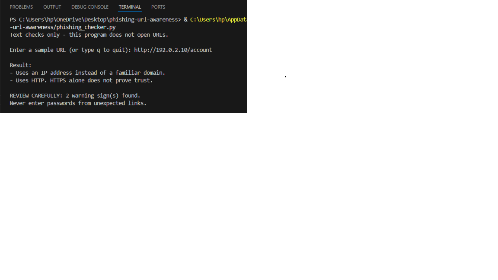
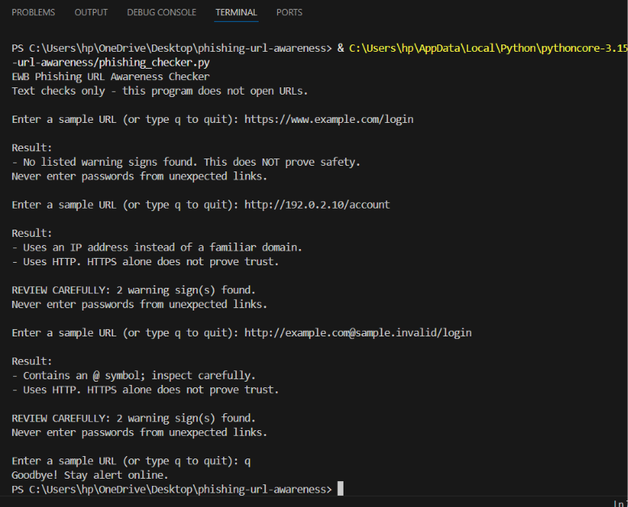
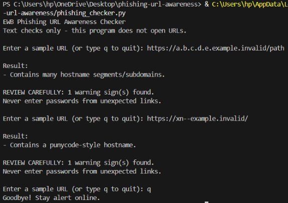

# EWB Phishing URL Awareness Checker

## Overview
Phishing is a type of online scam in which attackers send fake links to trick people into sharing passwords or private information. This project is a small Python program that reads a URL as plain text and warns about suspicious signs, such as an @ symbol, an IP address, a very long link or the use of HTTP. It never opens the link, so it is meant for learning and awareness only and does not prove that any URL is safe.

## Features
- Detects an @ symbol in the URL
- Flags unusually long URLs (over 100 characters)
- Flags IP-address hostnames
- Flags many hostname segments (5 or more)
- Flags punycode-style hostnames (xn--)
- Flags the HTTP scheme
- Improvement A: checks many URLs in one run (type q to quit)
- Improvement B: shows a REVIEW CAREFULLY summary with a warning count
- Improvement C: handles bad input such as http://[bad without crashing

## Requirements
Python 3. No extra packages are needed.

## How to Run
```
python phishing_checker.py
```

## Example Output
```
Enter a sample URL (or type q to quit): http://192.0.2.10/account

Result:
- Uses an IP address instead of a familiar domain.
- Uses HTTP. HTTPS alone does not prove trust.

REVIEW CAREFULLY: 2 warning sign(s) found.
```

## Testing
I tested five sample URLs and all gave the expected results. The full table is in `tests/test_samples.md`.

## Screenshots



## Improvements
1. Loop with quit: I added a loop so I can check many URLs in one run without restarting the program. Typing q stops it. I tested it by entering several URLs in a row and then typing q.
2. Review carefully summary: I added a summary line that counts the warning signs and says REVIEW CAREFULLY, so the result is easier to understand. I tested it with http://192.0.2.10/account, which showed 2 warning signs, and with a safe-looking URL, which showed no summary.
3. Malformed input handling: I noticed that typing http://[bad made the program crash with a ValueError. I added try and except so it now shows a clear message instead of crashing. I tested it by entering http://[bad again.## Limitations
This is an educational tool. It only reads URL text. It does not visit URLs,
scan for malware or prove that a URL is safe. No warning signs found does
NOT mean a URL is safe.

## Ethical Use
Use sample strings only. Do not collect credentials. Do not use this project
to deceive anyone or to test websites without permission.

## Author
D.Divya Jyothi, Cybersecurity Internship, EWB Courses